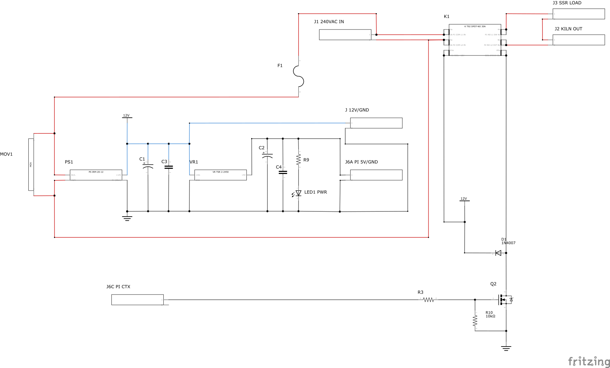

# Kiln Mains Board

Fritzing project for the mains side of the kiln controller: the 240 VAC 2-pole
contactor, its coil driver, and the 12 V/5 V supplies that run the Pi. Companion
to [`../PiHat`](../PiHat), which keeps the thermocouples, the Pi and the Arduino
safety watcher.

Open `Kiln Mains Board.fzz` in Fritzing 1.0.7 or later. The custom parts travel
inside the `.fzz`, so it opens standalone; `parts/` holds the same sources if you
want them in your own bin.

**Status: schematic complete and wired, PCB placed but not routed.** The coloured
lines in PCB view are ratsnest, not copper. See [Before you fab](#before-you-fab).



## The kiln this is built for

Seattle Pottery Supply 184, **240 V, 21 A, 5.04 kW**, on a **3-wire** receptacle
(L1, L2, GND, no neutral). Every sizing decision below follows from those three
numbers, so re-check the whole thing if you move it to another kiln.

## Scope

Two things deliberately live off this board:

- **The SSR is driven straight from the Pi.** Only the SSR's *load* loop passes
  through here, on J3. There is no HEAT net and no SSR drive terminal.
- **The contactor guard lives on the PiHat.** This board takes one command,
  `CTX` on J6C, and switches the coil. It does not second-guess it.

And one thing that is impossible rather than omitted: **no neutral means no
120 V**. There is no legal or safe way to derive it from L1-to-ground. For a
mains-powered kiln fan, run a 240 VAC fan across L1-L2. The `J 12V/GND` header
is a 12 V DC enclosure-fan tap, which is a different job.

## How it works

**Power path.** L1 and L2 come in on J1 and land on the two poles of K1. Pole 1's
switched output leaves on J3.1 to the external SSR and returns on J3.2; pole 2
goes straight through to J2.2. J2 feeds the elements. The SSR modulates one leg
every 2 s (`sensor_time_wait`); K1 is a safety disconnect that breaks **both**
legs and sees about two operations per firing, which is why 30 A contacts are
comfortable on a 21 A load.

**Coil drive.** A single low-side switch:

```
+12V ── K1 coil (A1 → A2) ── Q2 drain→source ── GND
        D1 across the coil, cathode to +12V
        R3 100R gate series, R10 10k gate pulldown
```

`CTX` arrives at J6C.1 from the PiHat at 5 V. The T92's 12 V coil is 86 Ω / 140 mA
with a **9.0 V operate voltage**, so the switch has to drop almost nothing: an
AO3400A at 32 mΩ costs 4.5 mV. **R10 is what makes "unpowered" mean "open"** — with
the gate floating (Pi booting, Pi crashed, J6C unplugged) charge would otherwise
accumulate and could close the contactor. **D1 must be cathode-to-+12V**; reversed,
it forward-conducts the moment Q2 turns on, shorting the rail and clamping the
coil to a diode drop.

**Supplies.** PS1 takes L1-L2 (universal input, non-polarised, so no neutral is
fine) through F1 and gives 12 V; VR1 bucks that to 5 V for the Pi on J6A.
MOV1's footprint sits across the fused line, downstream of F1 — so that a failed
MOV would blow the fuse rather than the branch breaker — but it is **not
populated**. See [Why MOV1 is not populated](#why-mov1-is-not-populated).

**Fail-safe.** F1 and PS1 tap L1/L2 *upstream* of the contactor, so the Pi is
alive before the contactor closes. If F1 blows, PS1 dies, the coil de-energizes
and the contactor opens — and the Pi loses its 5 V, so the SSR drops too.

## Netlist

`+12V` and `GND` are drawn with Fritzing net labels rather than wires. They are
real nets — click any pin and Fritzing highlights the whole net — but it is worth
confirming once when you open the file, since it is the only connectivity here
that rests on label bussing rather than drawn wires.

| Net | Pins | Members |
|---|---|---|
| `GND` | 11 | PS1.-V, VR1.GND, Q2.source, R10.2, C1.-, C2.-, C3.1, C4.1, LED1.cathode, J6A.2, J 12V/GND.2 |
| `+12V` | 8 | PS1.+V, VR1.+Vin, **D1.cathode**, K1.A1a, K1.A1b, C1.+, C3.0, J 12V/GND.1 |
| `+5V` | 5 | VR1.+Vout, C2.+, C4.0, J6A.1, R9.1 |
| `L2_IN` | 5 | J1.2, K1.6a, K1.6b, PS1.AC/N, MOV1.1 |
| `L1_IN` | 4 | J1.1, K1.2a, K1.2b, F1.1 |
| `COIL_LOW` | 4 | K1.A2a, K1.A2b, **D1.anode**, Q2.drain |
| `L1_FUSED` | 3 | F1.2, PS1.AC/L, MOV1.2 |
| `L1_SW` | 3 | K1.4a, K1.4b, J3.1 |
| `L2_OUT` | 3 | K1.8a, K1.8b, J2.2 |
| `G_Q2` | 3 | Q2.gate, R3.2, R10.1 |
| `L1_OUT` | 2 | J3.2, J2.1 |
| `CTX` | 2 | J6C.1, R3.1 |
| `LED1_A` | 2 | R9.2, LED1.anode |

J6C.2 is kept as a spare.

`MOV1` still appears on `L2_IN` and `L1_FUSED` because the **footprint** is
still placed. The part is not stuffed — see
[Why MOV1 is not populated](#why-mov1-is-not-populated).

`K1` terminals are named `2a/2b`, `4a/4b`, `6a/6b`, `8a/8b`, `A1a/A1b`, `A2a/A2b`.
**The `a` and `b` holes of each pair are one terminal**, two 1.93 mm holes on
5.16 mm centres. Both carry load current and both must be connected.

## Connectors

| Ref | Pitch | Function |
|---|---|---|
| J1 | 7.62 mm | 240 VAC in: 1 = L1, 2 = L2 |
| J2 | 7.62 mm | To kiln elements: 1 = L1 switched, 2 = L2 |
| J3 | 7.62 mm | External SSR load loop: 1 = from K1 pole 1, 2 = return to J2.1 |
| J6A | 5.08 mm | To PiHat: 1 = +5 V, 2 = GND |
| J6C | 5.08 mm | 1 = CTX (`gpio_contactor`, 5 V), 2 = spare |
| J 12V/GND | 5.08 mm | 12 V enclosure fan: 1 = +12 V, 2 = GND |

## Parts list

Link key: **[DS]** = datasheet PDF, downloaded and opened while writing this.
**[page]** = manufacturer or distributor product page — real, but not
fetch-checked, because those sites block scripted requests.

| Ref | Qty | Part | Spec | Datasheet |
|---|---|---|---|---|
| K1 | 1 | TE / P&B **T92S7D22-12** | DPST-NO, 30 A @ 277 VAC, 12 VDC coil (86 Ω, 140 mA, 9.0 V operate) | [DS](https://www.farnell.com/datasheets/2606696.pdf) · [page](https://www.newark.com/te-connectivity-potter-brumfield/t92p7d22-12/relay-dpst-no-277vac-28vdc-30a/dp/17M3087) |
| PS1 | 1 | Mean Well **IRM-20-12** | **85-305 VAC** in, 12 V **1.8 A / 21.6 W** out, OVC III, Class II (no FG pin), encapsulated, convection cooled. Has **no internal input fuse** — that is F1's job | [DS](https://www.meanwell.com/Upload/PDF/IRM-20/IRM-20-SPEC.PDF) |
| VR1 | 1 | Traco **TSR 2-2450** | 5 V 2 A buck, SIP3, 7805 pinout, no heatsink | [DS](https://www.tracopower.com/sites/default/files/products/datasheets/tsr2_datasheet.pdf) |
| Q2, Q3 | 2 | **AO3400A**, SOT-23 | Logic-level N-MOSFET, 30 V, 5.7 A at 25 °C, R<sub>DS(on)</sub> < 32 mΩ at V<sub>GS</sub> = 4.5 V. V<sub>GS</sub> absolute max is **±12 V**, so never drive the gate from the 12 V rail. Pinout **G-S-D** on pins 1-2-3, which is not the TO-220's G-D-S — see [Q2 and Q3: the pin numbering trap](#q2-and-q3-the-pin-numbering-trap) | [DS](https://www.aosmd.com/res/data_sheets/AO3400A.pdf) |
| D1, D2 | 2 | **LL4007**, MELF DO-213AB | Coil flyback, one per channel, cathode to +12 V. 1000 V 1 A, the surface-mount 1N4007. **M7 / S1M in SMA** is the more widely stocked equivalent but needs a different footprint | [DS](https://www.vishay.com/docs/88503/1n4001.pdf) |
| F1 | 1 | **T1A** slow-blow, 5×20 mm + PCB clips | Protects the PSU branch only, not the kiln. **Must be slow-blow** — PS1's cold-start inrush is 40 A at 230 Vac. **Must also be ceramic (sand-filled, HBC), not glass**: a glass 5×20 interrupts roughly 35 A at 250 Vac, and a residential 240 V outlet can deliver hundreds of amps of fault current. Confirm the body type before ordering — the linked series covers both. See the sizing note below for why this is 1 A and not 500 mA. | [page](https://www.littelfuse.com/products/fuses/cartridge-fuses/5x20mm-fuses/217) |
| MOV1 | **0 — DNP** | ~~S14K275 / V275LA20AP~~ | Footprint kept, **do not populate**. 275 VAC, 14 mm disc, 7.5 mm leads if you ever change your mind. See [Why MOV1 is not populated](#why-mov1-is-not-populated) | [DS](https://www.tdk-electronics.tdk.com/inf/70/db/var/SIOV_Leaded_StandarD.pdf) |
| C1, C2 | 2 | 10 µF 35 V aluminium electrolytic, **SMD, 4 × 5.4 mm can** (EIA 0405) | 12 V and 5 V rail bulk. A 10 µF 25 V X7R MLCC in 1206 is the no-wear-out alternative, but derates to roughly 4 µF at 12 V under DC bias — fine here, since both rails are already regulated | — |
| C3, C4 | 2 | 100 nF 50 V X7R, **1206** | rail decoupling | — |
| R3, R12 | 2 | 100 Ω, **1206** | gate series, one per channel | — |
| R10, R11 | 2 | 10 kΩ, **1206** | gate pulldown — do not omit | — |
| R9 | 1 | 1 kΩ, **1206** | LED series. About 3 mA into a 2 V green part | — |
| LED1 | 1 | Green **1206** | 5 V rail indicator, board-level only | — |
| J1, J2, J3 | 3 | **Phoenix Contact PC 5** 2-pos, 7.62 mm | 41 A / 10 mm². Do not substitute a 5 mm block — those stop around 16 A | [page](https://www.phoenixcontact.com/en-us/products/pcb-terminal-blocks-and-pcb-connectors/pcb-terminal-blocks) |
| J6A, J6C, J 12V/GND | 3 | 2-pos, 5.08 mm terminal block | SELV side, any make | — |

Off-board, but part of the design:

| Part | Spec | Datasheet |
|---|---|---|
| **SSR** | Auber **SRDA25** — 25 A, 24-480 VAC, zero-cross, 3-32 VDC input. 57 × 45 × 32 mm, M4 load screws, M3 control screws. Driven from the Pi, not from this board. **21 A on a 25 A part is 84 % of rating, continuously** — see [SSR and heatsink margin](#ssr-and-heatsink-margin). | [page](https://www.auberins.com/index.php?main_page=product_info&products_id=9) |
| **SSR heatsink** | Auber **HS25** — 80 × 50 × 50 mm, M4-0.7 thread. Auber rates it to let the SSR *“handle up to 25 Amp without forced air cooling (in an open air environment)”*. **The parenthetical is the whole ballgame** — see [SSR and heatsink margin](#ssr-and-heatsink-margin). Use thermal compound or a pad. | [page](https://www.auberins.com/index.php?main_page=product_info&cPath=2_48&products_id=45) |
| **Kiln fan** | 240 VAC axial across L1-L2 — Sunon `DP201A2123HST.GN` (120 mm) or ebm-papst `4656N` (119 mm). 230 V ±10 % covers 240 V, and no neutral is needed. | [page](https://www.tme.eu/en/details/dp201a2123hst/ac230v-fans/sunon/dp201a2123hst-gn/) |

## Mechanical: the standoff stack

The board no longer sits on the panel, and it carries the Raspberry Pi above it
on the same four holes. Both boards hang off **MH1-MH4**, the 58 x 49 pattern
straddling the two power supplies.

One M2.5 fastener runs through each hole. Bottom to top: a screw comes up
through the panel into a **10 mm female-female standoff**; the mains board sits
on that; a **30 mm male-female standoff** drops its stud through the board hole
into the same female thread, clamping the board; the Pi sits on top of that and
is held by a short screw.

| Surface | z, mm |
|---|---|
| back panel, top face | -1.60 |
| mains PCB, underside | 8.40 |
| mains PCB, top face | **0.00 datum for the board** (10.00 in the chassis) |
| PS1 / PS2, top | 34.11 |
| Pi microSD holder, lowest point | 38.00 |
| Pi PCB, underside | 40.00 |
| top of the HAT stack | 64.20 |

### Hardware BOM

**Why 30 mm and not 35.** M2.5 male-female hex standoffs are stocked at 5, 6, 9,
10, 15, 20, 25 and 30 mm. **35 mm is not a stocked M2.5 length** — it only shows
up from M3 upward — so the Pi sits 30 mm above the board rather than the 35 mm
that would be more comfortable. See the clearance note below.

| Qty | Item | Where | Note |
|---|---|---|---|
| 2 | M2.5 x 10 mm hex standoff, **brass**, female-female | MH2, MH4 — panel to board | Assmann WSW **V6622C** is an M2.5 x 10 mm brass hex standoff listed at DigiKey; confirm the gender before ordering, I could not fetch the page (403) |
| 2 | M2.5 x 10 mm hex standoff, **nylon**, female-female | MH1, MH3 — panel to board | nylon for the 240 V clearance below |
| 2 | M2.5 x 30 mm hex standoff, **brass**, male-female, 6 mm stud | MH2, MH4 — board to Pi | |
| 2 | M2.5 x 20 mm **+** M2.5 x 10 mm hex standoff, **nylon**, male-female | MH1, MH3 — board to Pi | stack the two to make 30 mm. Nylon M2.5 male-female is commonly stocked at 12 and 20 mm; a single 30 mm nylon piece is not something I could confirm |
| 4 | M2.5 pan-head screw, panel thickness + 5 mm | under the panel | into the lower standoff |
| 4 | M2.5 x 6 mm pan-head screw | Pi to standoff top | nylon at MH1, MH3 |

Lengths were checked against live listings rather than assumed. Distributor
pages at DigiKey and Keystone return 403 to scripted fetches, so the length
availability above comes from catalogue listings that did resolve; treat the one
part number as a starting point, not a verified order line.

### Two of the four standoffs must be nylon

**MH1 and MH3 land 2.35 mm from 240 V copper.** They sit at board x 19.74, and
the nearest mains pads are PS2's `AC/L` at (25.89, 3.66) and PS1's `AC/N` at
(25.89, 52.12). Centre to centre is 6.15 mm; subtract the 1.30 mm pad radius and
the 2.50 mm standoff radius and 2.35 mm of board surface is all that is left.

That is not enough. IEC 60664-1 at 250 V working, pollution degree 2, material
group IIIa wants 2.5 mm creepage for **basic** insulation and about 5.0 mm for
**reinforced**. The mains-to-SELV boundary on this board should be reinforced,
because the IRM-20s are what make the output SELV in the first place.

**The Pi's mounting holes are tied to Pi ground**, so a brass standoff there is
not floating metal — it is SELV ground brought to within 2.35 mm of mains.
Nylon removes the conductor entirely and the problem with it.

It cannot be fixed by moving things. The pattern must span 58 mm to straddle the
52.70 mm supply block, and the IRM-20's AC pins sit 3.4 mm inside one end of its
52.4 mm footprint, so whichever way the supplies face, one hole pair lands about
6 mm from the AC pads. MH2 and MH4 are clear — 10.44 mm and 3.13 mm to the
nearest copper, and both of those are DC.

### Clearances worth watching

**3.89 mm between the supplies and the Pi.** PS1 and PS2 top out at z 34.11 and
the Pi's microSD holder reaches down to 38.00. That is the tightest gap in the
stack and it sits directly over two convection-cooled 20 W supplies with a PCB
lid above them. If it runs hot, the fix is to give the board its own mounting
holes so the Pi can go on 40 mm female-female standoffs instead of being capped
at 30 mm by the shared-hole arrangement.

**The board is supported only at MH1-MH4.** Those are at x 19.74 and 77.74 on a
101.10 mm board, which leaves a 19.74 mm cantilever at the mains-input end and
23.36 mm at the connector end. The mains end is where J4's screw terminals get
torqued, so that corner will flex. Two more holes near x 4 would fix it.

### SSR and heatsink margin

This is the tightest thermal spot in the design, so the arithmetic is worth
writing down.

**The SSR dissipates about 25 W.** At 21 A with a typical 1.2 V on-state drop
that is 25 W; across the 1.1-1.6 V range these parts actually show, 23 to 34 W.
It is not an averaged figure — during a ramp the SSR sits at high duty for long
stretches, so treat it as continuous.

**The HS25 is roughly 2-3 °C/W.** Auber publishes no thermal resistance, so that
comes from the size: an 80 × 50 × 50 mm extrusion in still air. At 25 W that is a
**60-75 K rise**. In a 30 °C room the baseplate lands at 90-105 °C. Sealed in a
controller enclosure with two mains supplies also making heat, it lands higher.

Auber's own rating says *"in an open air environment"*, and that qualifier is
doing the work. A closed box is not open air.

Three ways to buy margin, cheapest first:

- **Bolt the heatsink to the enclosure wall** so the wall spreads heat too, or
  mount the SSR on the outside of the wall entirely. Costs nothing.
- **Add a fan.** Forced air is worth roughly a factor of three on a sink this
  size, and it turns a marginal number into a comfortable one.
- **A bigger sink, or a larger SSR.** A 40 A part run at 21 A drops less and has
  more die to spread it.

Worth knowing what changed: this board was originally specced around a
**Crydom CWD2450 at 50 A**, chosen so a 21 A load sat at 42 % of rating. The
SRDA25 puts it at 84 %. That is a normal thing to do, but it is a deliberate
trade of margin for cost, not a like-for-like swap.

**LED1's colour is a property, not a part.** Every green 5 mm LED variant in this
Fritzing library is obsolete with a missing schematic SVG, so LED1 stays the
generic 5 mm LED with `color=green`. The BOM reads green; stuff a green one.

### Why MOV1 is not populated

The footprint stays on the board, because keeping the option costs nothing and
removing it would mean a re-layout. Leave it empty.

**PS1 already handles the case the MOV was there for.** The IRM-20 datasheet
rates it at EN/IEC 61000-4-5 **level 4, 2 kV line-to-line, criteria A** — normal
operation during and after the surge, with no external components. It is OVC III
and Class II with 4.2 kVac input-to-output isolation. A 275 V MOV in front of
that is protecting a part that does not need protecting.

**And it would not catch the interesting case anyway.** Lightning couples into
premises wiring predominantly as **common mode**, L1 and L2 rising together
against earth. MOV1 sits L1-to-L2, so it is a spectator to exactly the event
people fit MOVs for. Catching common mode needs L-G and N-G paths, which this
board has no business providing — that is service-entrance and point-of-use work.

**A MOV is not free.** Its failure mode is a **short**, reached by slow
degradation: leakage rises, the disc self-heats, and it runs away. That is why it
must sit downstream of F1, and it is a new failure mode on a board that runs
unattended for ten-hour firings. A TMOV's thermal disconnect addresses the
failure mode but adds no surge capacity, so it does not change this reasoning.

**The intended surge mitigation is a panel SPD**, not a board-level part: a Type
2 device at the service entrance, optionally with a Type 3 at the point of use.
Coordinated protection upstream beats an uncoordinated 14 mm disc downstream, and
it protects the kiln and the SSR too, neither of which MOV1 ever covered.

If you do populate it, F1 must already be the ceramic HBC part above: a shorted
MOV puts the full available fault current through that fuse.

### Packages

Everything on this board that has a surface-mount equivalent is surface mount.
What is left through-hole is left that way on purpose:

| Part | Why it stays through-hole |
|---|---|
| PS1, PS2 | The IRM-20 family is an encapsulated THT module. There is no SMD version of the part. |
| F1 | See [Why F1 stays a 5 × 20 cartridge](#why-f1-stays-a-5--20-cartridge). |
| Mains and coil terminal blocks | A screw terminal takes wire-pull force. SMD pads peel; plated holes do not. Nothing surface-mount is rated for the current or the mechanics. |
| MOV1 | DNP anyway — see [Why MOV1 is not populated](#why-mov1-is-not-populated). |
| K2, K3 | Panel-mount relays with QC tabs. They have no board connection at all. |

The conversion moved nothing: every part kept its centre and its rotation, and
the netlist came out identical. It removed **30 drilled holes** and added
**30 surface-mount pads**, and the board still has zero pad-to-pad clearance
violations at 8 mil.

Two details that are easy to get wrong when swapping packages in Fritzing.
**Rotation is encoded as a translation derived from the footprint size**
(`m31 = cx - (m11·cx + m21·cy)`), so reusing the old matrix with a new footprint
walks every rotated part off its position; each one is re-derived. And
**geometry x,y is the bounding-box corner, not the centre**, so each part is
also shifted by half the size change, which is what actually keeps the placement
where you put it.

### Q2 and Q3: the pin numbering trap

The coil drivers are **AO3400A in SOT-23**, and the reason that specific package
is worth a section is that it very nearly went in backwards.

Fritzing's generic FET numbers its connectors **G-D-S** (`connector0/1/2`). The
SparkFun SOT-23 part numbers them **G-S-D**, which is the real SOT-23 pinout.
Swap the part without renumbering and drain and source trade places — and
nothing complains, because both nets still exist and every pin is still
connected. The fix has two halves, and the second is the one you forget:

1. the FET's own `connectorId`s, in all three views, and
2. **every `<connect>` in every other instance that points at the FET**, i.e.
   the wires landing on the drain and the source.

The check that catches it is re-extracting the netlist and looking for `Q2.D` on
the coil-low net with `D1.anode` and `K2.A2`, and `Q2.S` on `GND`. Backwards,
`Q2.S` shows up on the coil.

The symbol does not change. The two schematic SVGs are identical apart from the
"2"/"3" pin labels, drain at the top in both, so no schematic wire moved.

**Why not IRLZ44NS in D2Pak**, which would have been the same silicon and no
renumbering at all: it does not fit. Both surface-mount FET footprints in
Fritzing's library are wider than the TO-220 in the axis where the coil-driver
column has no room — D2Pak 0.685 in and DPak 0.472 in against the TO-220's
0.280 in as placed, on a 100 mil pitch. Either one lands copper on R3/R10/D1
and R11/R12/D2, measured at up to **−88 mil** of clearance. SOT-23 is 0.118 in
square and drops into the TO-220's old space with room to spare.

**The margin is still absurd.** The coil is 12 V, 86 Ω, 140 mA. At the
datasheet's 32 mΩ the AO3400A drops 4.5 mV and dissipates 0.6 mW against a 1.4 W
package. R<sub>DS(on)</sub> is specified all the way down to V<sub>GS</sub> =
2.5 V (< 48 mΩ), so the 5 V `CTX` drive sits well inside the characterised
region rather than near a threshold. The 30 V drain rating sounds like a
step down from the IRLZ44N's 55 V, but D1 clamps V<sub>DS</sub> to roughly
12.7 V, so it is not the constraint — **which is another reason D1 is not
optional**.

The one real cost is assembly: SOT-23 is the fiddliest thing on this board to
hand-solder.

### Why F1 stays a 5 × 20 cartridge

The whole point of F1 is breaking capacity — see its row above. Surface-mount
fuses rated for 250 VAC exist, but 250 V is thin for a 240 V nominal supply once
you allow +10 %, and the high-breaking-capacity options at that voltage are
neither cheap nor widely stocked. A ceramic 5 × 20 in clips is the part that
does this job well, and it is the one part on the board you might actually want
to replace by hand.

## Custom Fritzing parts

Nine `.fzp` files in [`parts/`](parts), modelling seven physical parts. The `…R`
variants are the same footprint with the schematic symbol mirrored, so input
terminals can sit on the left of the sheet and still have their pins face right.

| Fritzing part | Models | Footprint source |
|---|---|---|
| `T92S7D22_12_kilnmains` | TE T92S7D22-12 relay | TE datasheet 1308242 rev 1217, termination code 1 |
| `T92P7D22_12_kilnmains` | TE T92P7D22-12 relay, **mechanical footprint only** | TE datasheet 1308242 rev 1217, termination code 2 |
| `IRM_20_12_kilnmains` | Mean Well IRM-20-12 | Mean Well case 219A (bottom view, mirrored to top-down) |
| `TSR_2_2450_kilnmains` | Traco TSR 2-2450 | Traco TSR 2 outline drawing, SIP3 |
| `MOV_S14K275_kilnmains` | 14 mm disc MOV | generic radial, 7.5 mm lead pitch |
| `TB2_762_kilnmains`, `…762R` | 7.62 mm terminal block | generic, sized to Phoenix PC 5 |
| `TB2_508_kilnmains`, `…508R` | 5.08 mm terminal block | generic |

These exist because Fritzing 1.0.7 ships its screw-terminal parts without
schematic or PCB SVGs on disk, and its only varistor is an 0603 chip part.

### Installing one of these parts: zip it first

`parts/` is laid out as an **unzipped `.fzpz`** — `part.<id>.fzp` beside
`svg.<view>.<id>_<view>.svg`. That flat, dot-separated naming is what Fritzing
expects *inside a zip*, which is why the same files serve both a `.fzpz` (one
part) and the `.fzz` (the whole sketch).

**Dragging the loose `.fzp` into Fritzing does not work.** A loose `.fzp` is
resolved against the `image=` paths in its own view stanzas, so Fritzing rewrites
`breadboard/foo_breadboard.svg` to `breadboard.foo_breadboard.svg` and looks for
that next to the `.fzp` — with no `svg.` prefix. It isn't there, and you get:

> Local part '…/part.X.fzp' incomplete, subfile not found 'breadboard.X_breadboard.svg'

Zip it and the prefix lines up again:

```bash
python3 tools/make_fzpz.py T92P7D22_12_kilnmains
```

Then drag the resulting `parts/<id>.fzpz` in. `--all` repackages every part.

### `T92P7D22_12_kilnmains` — the panel-mount relay (hybrid part)

Same relay as `T92S…`, different terminals. The product code decodes as **P**
dust-protected case / **7** two form A / **D** DC coil / **2** panel mount via
flanged cover with .250 in (6.35 × 0.81 mm) QC tabs / **2** AgCdO / **-12** twelve
volt coil.

It is a **hybrid part**. All six relay terminals are real connectors in schematic
and breadboard, so the coil driver and the mains nets connect normally and the
sheet documents the real circuit. In `pcbView` every one of them carries
`hybrid="yes"`, so there is no pad, no ratsnest and nothing to route. The board
gets the outline plus two mounting holes, and those are not connectors at all.

| | |
|---|---|
| Flange envelope (keepout) | 68.58 × 34.54 mm |
| Case body | 52.07 mm wide, same 34.54 depth |
| Mounting centres | 59.56 ± 0.13 mm, **non-plated** 4.5 mm for a #8 or M4 |
| Case above the flange | 26.42 mm |
| Overall including tabs | 37.97 mm |

**The flange plane is flush with the top of the case**, so the relay stands on its
flange with the body and tabs rising 37.97 mm clear of the board. No cutout, no
standoffs, and the tabs are wired from above.

Two things the drawing hides. The datasheet plan view is a **bottom** view and a
PCB footprint is a top view, so the tab marks in the silkscreen are mirrored —
coil on the left, contacts on the right. And the outer rectangle is drawn square
even though the real flange corners are chamfered, because the chamfer is not
dimensioned and the full rectangle is the conservative keepout.

#### How the two "invisible on the board" tricks work

Both were checked against Fritzing 1.0.7's own exporter, not guessed.

**Hybrid connectors.** `<p layer="copper0" svgId="connectorNpad" hybrid="yes"/>`
(plus the copper1 twin) means "this connector is not really in this view". The
matching `connectorNpad` element is simply absent from the PCB SVG. Of the three
spellings that work, only this one loads silently — `layer="unknown"` and an
empty `<pcbView/>` both log `svgidlayer fail`.

**Non-plated holes.** A **filled** circle whose id starts with `nonconn` exports
as a non-plated hole and contributes no copper at all. A **ring** (`fill:none`
plus a stroke) exports as a *plated* hole with an annular ring. Proven by
exporting a probe board carrying both forms:

```
T1C0.177165     <- filled nonconn, 4.5 mm   NON-PLATED
T101C0.177165   <- ring   nonconn, 4.5 mm   plated, 5.2 mm ring in copper
```

Fritzing's own panel-mount parts (Taiway toggle switch mounting hole, Dagu servo
mounting holes) use the filled form. The finished part exports exactly two
non-plated 4.5 mm holes on 59.56 mm centres, zero plated holes, and zero copper
flashes on either layer.

One pre-existing quirk, not caused by any of this: every part in this library
logs one `svgidlayer fail … vid:2` per connector on load (`T92S` logs 12, `T92P`
logs 6). Both render and route correctly; it is noise from how `make_schem_svg`
emits pins.

#### Re-importing after a change

Fritzing prefers a part **already installed** under a given `moduleId` over one
supplied in a sketch or a freshly dragged `.fzpz`. Editing a part and re-dragging
it can silently keep loading the old one. Delete the old part from the parts bin
first (right-click → Delete Part), or bump the `moduleId`.

Pads are emitted **once** inside nested `<g id="copper1"><g id="copper0">`, which
is what every core Fritzing THT footprint does. Defining them twice duplicates
the element ids, and Fritzing then resolves `connector<N>pad` on copper1 only —
the copper0 lookup fails and the pad is silently dropped from the bottom-copper
gerber. That bug was in these parts and is fixed; `tools/gen_parts.py` carries a
comment so it does not come back.

## Copper pours and "ground"

**Do not put a ground plane on this board** — not a global one, and nothing at
all on the mains half.

Three reasons:

- **Creepage.** `GND` here is the SELV 0 V, isolated from mains by PS1 (4.2 kVac
  withstand). A SELV pour has to hold the full **8 mm reinforced barrier** from
  every mains trace and pad. On the mains half that keepout eats essentially all
  the free area — K1 alone has 12 pads and the 7.62 mm blocks are wide — and
  every re-pour is a fresh chance to neck the barrier below 8 mm without
  noticing.
- **It would bridge the isolation slot.** The whole point of the dead band at
  `y = 54.5 … 66 mm` is that nothing crosses it. A pour drawn across it undoes
  PS1's isolation in one stroke.
- **The benefits are close to zero here.** Planes buy low-impedance return for
  fast edges, EMI shielding, and thermal spreading. Nothing on this board is
  fast (the SSR duty cycle is 2 s; the gate drive is DC through 100 Ω), PS1 is
  EMI Class B with no external components, and the heat is either self-contained
  (PS1) or in the relay body (the coil's 1.7 W) or off-board (the SSR).

What to do instead:

- **Mains half: no pour.** Discrete wide traces at the widths in item 1, with
  spacing you can see and measure.
- **SELV half: optional bottom-layer `GND` pour**, confined to the SELV band,
  with a keepout covering the isolation band *and* the whole mains band. It is
  mildly convenient for the 11 ground pins. It is not required — routing them is
  fine too.

**And note `GND` is not earth.** It is SELV 0 V. PS1 is Class II, so the board
itself needs no PE connection, and there is no PE terminal on it. The protective
earth from the 3-wire feed must still bond to the enclosure and to the SSR
heatsink — do that with a stud in the enclosure, not through this PCB. Whether
to bond SELV 0 V to PE at a single point is a separate decision; with a
networked Pi it is usually worth doing, once, in the enclosure.

## Before you fab

Nothing here is fab-ready yet. In order:

1. **Route it.** Placement is done, copper is not. Two different mains
   currents live on this board, so they get two different trace widths:

   | Path | Current | Width (2 oz) |
   |---|---|---|
   | Kiln load: `L1_IN` → K1 → `L1_SW`/`L2_OUT` → J3/J2 | 21 A | **5.1 mm min, 6 mm preferred** |
   | PSU branch: `L1_FUSED` (F1 ↔ PS1) and the L2 stub | 0.4 A | **1.5–2 mm** |

   The 21 A figure is IPC-2221 at a 30 °C rise (3.4 mm if you order 3 oz). 6 mm
   gives margin with no solder-bead tricks.

   The PSU branch is **not** sized by current — PS1 draws 0.4 A at 230 VAC
   (datasheet typ; well above P/V because there is no PFC), and 0.4 A needs
   0.08 mm of 1 oz. 1.5–2 mm is chosen so the trace outlives F1 during a fault
   and to be mechanically sane on a mains net. With MOV1 unpopulated the likeliest
   fault is inside PS1, but the reasoning is unchanged: the copper must never be
   the thing that clears. At 2 oz, 1.5 mm carries ~8.7 A and 2 mm ~10.7 A continuous, both
   far beyond the fuse-clearing window.

   The PSU branch taps off the `L1_IN` / `L2_IN` pours, which are already wide
   for the kiln current. Keep the stub from the L1 pour to `F1.1` **short** — it
   is upstream of the fuse, so it is protected only by the 30 A branch breaker.

   If MOV1 is ever populated, its surge rating still does not drive trace
   width: an 8/20 µs pulse deposits negligible energy in copper. Keep its loop
   short because a MOV should sit electrically close to what it protects, not
   for heating.
2. **Verify the custom footprints** against a 1:1 printout with the real parts in
   hand. Standard practice for any custom footprint, and these were derived from
   datasheet drawings, not vendor CAD:
   - `T92S7D22_12_kilnmains` — the TE drawing is **not to scale**, so the printed
     dimensions were used and the pixel geometry ignored.
   - `IRM_20_12_kilnmains` — Mean Well case 219A is a **bottom view**; it is
     mirrored here into a top-down footprint. Worth a second look.
   - `MOV_S14K275_kilnmains`, `TB2_*` — generic, sized from the part class.
3. **Cut the isolation slot.** The band `y = 54.5 … 66 mm` is deliberately empty.
   Add a routed slot down the middle of it in the board outline. A kiln room is
   pollution degree 3 (silica dust), so budget 8 mm creepage mains-to-SELV.
4. **Spacing, which matters more than width.** Kiln room is pollution degree 3
   (silica dust), 240 V working:
   - **≥ 4 mm creepage mains-to-mains** (L1 to L2, basic insulation, material
     group IIIa). This subsumes the clearance requirement.
   - **8 mm mains-to-SELV** across the isolation barrier, as in item 3.

   Two 2 mm traces at 4 mm spacing is 8 mm of board width for the pair — budget
   for it before you start pouring.

   And treat both legs as live: 3-wire means neither is "cold". Both sit at 120 V
   to ground and 240 V to each other, so keep clearances symmetric across the
   whole mains section.
5. **Conformal coat** the finished board.
6. **Re-export gerbers and check top vs bottom pad counts match.** That is how the
   dropped-copper0 bug above was caught, and it is a cheap standing check.

## Regenerating

The custom parts are generated; the sketch is hand-edited in Fritzing.

```bash
python3 tools/gen_parts.py      # rewrites parts/ (safe, does not touch the .fzz)
```

`tools/gen_sketch.py` built the *original* sketch and is kept for reference, but
**running it now would overwrite the current hand-drawn schematic**. Don't.

To re-render, and to re-check the copper layers:

```bash
/Applications/Fritzing.app/Contents/MacOS/Fritzing -svg <folder-containing-the-fzz>
/Applications/Fritzing.app/Contents/MacOS/Fritzing -gerber <folder-containing-the-fzz>
```

## Also worth fixing

`config.py:35` has `kw_elements = 9.460`, inherited from upstream's Skutt. This
kiln is 5.04 kW, so every cost figure the UI reports is about 1.9× high.
